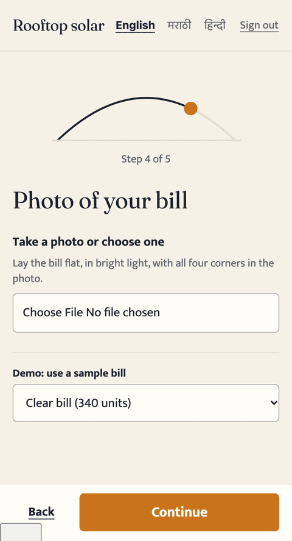
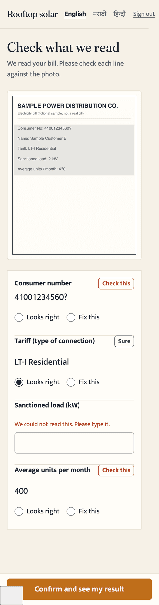
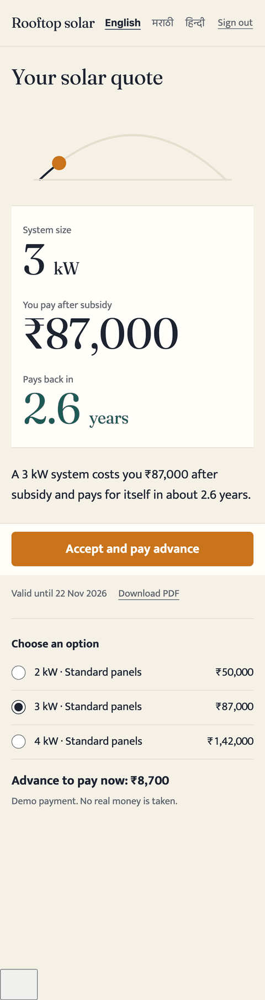
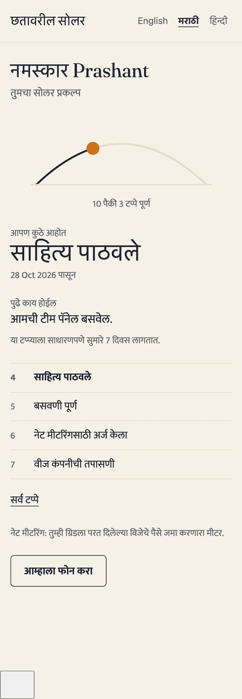

# Rooftop Solar: lead to project

A small, working app for Company A (Nagpur). A homeowner answers a few questions and uploads a bill photo; the app says who is worth a visit and what size fits; sales sends a same-day quote with subsidy and payback worked out; the project is tracked to "subsidy credited" with a customer status link. English, मराठी and हिन्दी.

> **Honest status:** bill reading is **simulated** (a deterministic reader behind an adapter; no external AI), and OTP, messages and payments are **mocked**. The subsidy rule is the client's statement and is **unverified**. See [docs/AI.md](docs/AI.md) and [docs/TDD.md](docs/TDD.md).

| Lead form | Bill review | Quote story | Project status |
|---|---|---|---|
|  |  |  |  |

## Quick start
```bash
npm install
cp .env.example .env.local        # fill in the names listed there
npm run db:migrate && npm run db:seed
npm run dev
```
Full steps, demo logins (OTP `123456`) and deployment: [deployment.md](deployment.md).

## Checks
`npm run lint` · `npm run typecheck` · `npm test` (231) · `npm run test:cov` · `npm run e2e` (10)

## Docs
[TDD](docs/TDD.md) · [PRD](docs/PRD.md) · [Architecture](docs/ARCHITECTURE.md) · [Data model](docs/DATA_MODEL.md) · [Design system](docs/DESIGN_SYSTEM.md) · [Security](docs/SECURITY.md) · [Testing](docs/TESTING.md) · [AI](docs/AI.md) · [Assumptions](docs/ASSUMPTIONS.md) · [i18n](docs/I18N.md) · [Lighthouse](docs/LIGHTHOUSE.md) · [Plan](docs/IMPLEMENTATION_PLAN.md)
