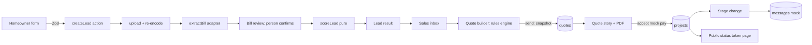

# Architecture

## Stack and why
| Choice | Why (interview answer) |
|---|---|
| Next.js App Router + TS strict | One codebase for UI + server actions; server components keep the 3G JS budget small |
| Postgres (Neon) + Drizzle | Relational data with dated rules; Drizzle gives typed SQL and checked-in migrations |
| `jose` | Maintained JWT signing; we never hand-roll crypto |
| Zod | Single validation layer for inputs and env; also validates extractor output |
| Tailwind + CSS variable tokens | Custom look from tokens, no component-library look |
| `@react-pdf/renderer` | Server-side PDF from the same data as the quote page; embeds Devanagari font |
| Vitest / Playwright | Fast unit tests for the rules engine; 3 mobile E2E flows |

Every dependency must justify itself; unused packages are removed (see SECURITY.md hygiene).

## Folder structure
```
app/            routes (server components by default), server actions
components/     UI (custom), sun-arc, chips
lib/rules/      PURE functions: effective rule, subsidy, generation, payback, size, score
lib/ai/         extractBill adapter + simulated backend + Zod schema
lib/auth/       otp, session, rbac
lib/messaging/  provider.ts (mock) + templates
lib/i18n/       typed message files en/mr/hi
lib/storage/    bill/document store (DB bytea for demo)
db/             schema.ts, migrations/, seed.ts
docs/ tests/ e2e/
```

## Module boundaries
- `lib/rules/*` imports nothing from db, env, next or date-now. Callers pass rows and dates in. This is what makes it 100% testable.
- `lib/ai/*` returns untrusted data. Only `app/` actions turn it into stored values after a person confirms.
- DB access only in `db/` and server actions/loaders; components never query.

## Data flow (lead → quote → project)


## extractBill adapter
```ts
interface BillReader { extract(image: Buffer, mime: string): Promise<BillExtraction> }
```
`lib/ai/index.ts` exports `extractBill`, which calls the configured reader, validates the result with Zod, runs plausibility checks, and on any throw returns `unreadable` → manual entry. Today the only reader is `simulated`. A real OCR/vision service would implement `BillReader`; nothing else changes.

## Rules-engine purity
No I/O, no `Date.now()`, no floats for money (integer paise). See CODE_STYLE.md.

## Mocking boundaries
OTP (fixed code, logged), messages (`messages` rows with `mock_sent`), payments (`payments` row, mode mock), bill reading (simulated), DISCOM/subsidy portal (not integrated). PDF is real.

## Deployment topology
Vercel (Next.js, Node runtime) → Neon Postgres. Region: Mumbai (ap-south-1) if offered, else flagged as a DPDP limit (SECURITY.md). Secrets via Vercel env vars.

## Performance budget (3G)
Lead flow initial JS target ≈ 100 KB gzip (measured: ~158 KB, mostly the React + Next runtime; see docs/LIGHTHOUSE.md); fonts self-hosted WOFF2 subsets, 2 families; lead form route < 3 s on Slow 3G + 4× CPU (measured, recorded in TDD only after measuring); skeletons for lists; images downscaled server-side; service worker caches the shell.
