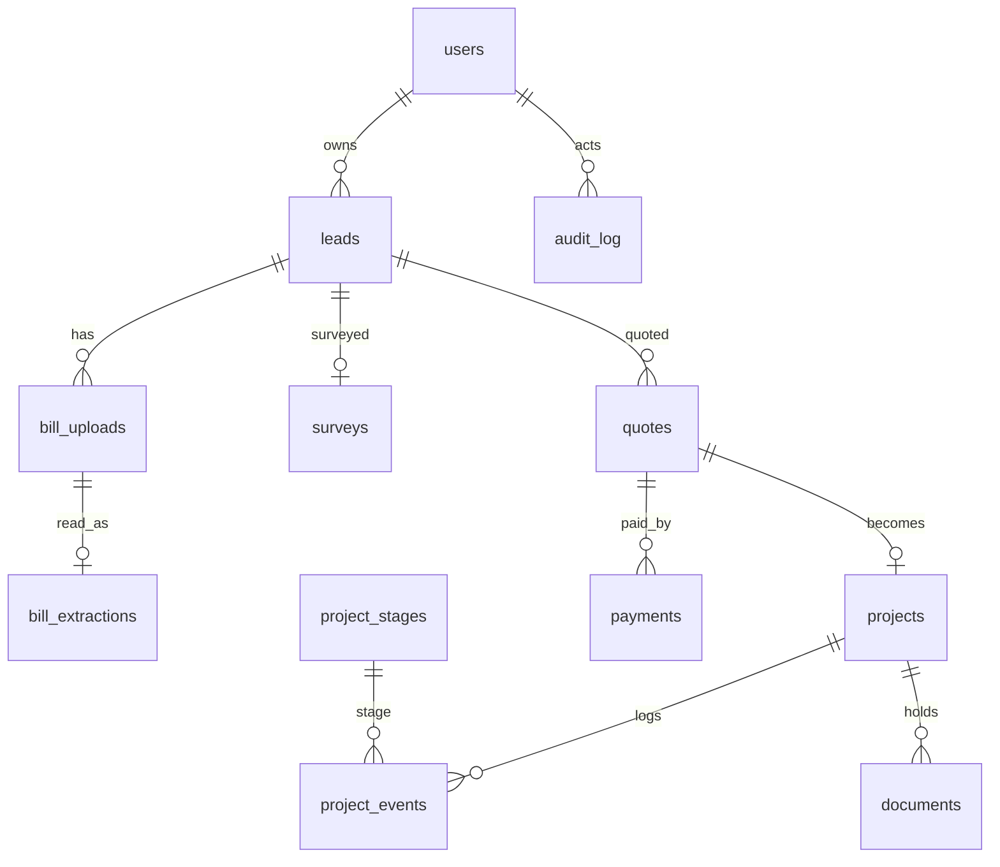

# Data model

Money is **integer paise**. IDs are UUIDs; leads also have human IDs (`LD-30881`). All timestamps `timestamptz` (UTC), displayed in Asia/Kolkata.

## Tables
- **users**(id, phone unique, name, role `homeowner|sales`, is_admin, language `en|mr|hi`, created_at)
- **otp_challenges**(id, phone, code_hash, expires_at, attempts, consumed_at, ip, created_at)
- **leads**(id, human_id unique, owner_user_id→users, owner_type `owner|tenant`, roof_type, roof_area_sqft, monthly_bill_paise, pincode, consent_at, consent_text_version, status, score int, score_band `high|medium|low`, score_reasons jsonb, next_step `survey|call`, recommended_kw numeric(4,1) null, idempotency_key unique, created_at)
- **bill_uploads**(id, lead_id, storage_key, bytes_data bytea, mime, bytes, sha256, quality_flag `good|poor|unknown`, attempt_no, uploaded_at)
- **bill_extractions**(id, upload_id, backend `simulated`, raw_json jsonb, extracted_json jsonb, consumer_no, tariff, sanctioned_load_kw, avg_units_month, confidence_json jsonb, status `pending|confirmed|edited|rejected_photo`, confirmed_by, confirmed_at)
  - Both extracted and confirmed values are kept so accuracy can be measured later.
- **surveys**(lead_id pk, roof_ok, usable_area_sqft, shading, notes, surveyed_by, at)
- **price_rules**(id, kw, tier `standard|premium`, price_paise, effective_from, effective_to)
- **subsidy_rules**(id, scheme, customer_type, per_kw_paise, first_kw_limit, extra_kw_paise, cap_paise, effective_from, effective_to, verified bool, source_note)
- **app_settings**(key, value, effective_from) — `units_per_kw_year`, `tariff_rate_paise_per_unit`, `tariff_escalation_pct`
- **quotes**(id, lead_id, version, status `draft|sent|accepted|expired`, inputs_snapshot jsonb, outputs_snapshot jsonb, rule_ids_used jsonb, created_by, sent_at, valid_until)
- **projects**(id, quote_id unique, stage_code, status_token_hash, token_revoked_at, started_at, stage_entered_at)
- **project_stages**(code pk, label_en, label_mr, label_hi, order, stuck_after_days)
- **project_events**(id, project_id, stage_code, note, actor_user_id, at)
- **documents**(id, project_id, kind, filename, storage_key, bytes_data, uploaded_by, at)
- **messages**(id, to_phone, channel `whatsapp|sms`, template, body, lang, status `queued|mock_sent`, created_at)
- **audit_log**(id, actor_user_id, action, entity, entity_id, at, meta jsonb) — no PII in meta
- **payments**(id, quote_id, amount_paise, mode `mock`, ref, status)

## Indexes
`users(phone)`, `leads(owner_user_id)`, `leads(status, score_band)`, `leads(pincode)`, `leads(idempotency_key)`, `quotes(lead_id)`, `projects(stage_code, stage_entered_at)`, `projects(status_token_hash)`, `otp_challenges(phone, created_at)`, `price_rules(kw, tier, effective_from)`, `subsidy_rules(customer_type, effective_from)`.

## Effective dating
A rule row applies on date `d` if `effective_from <= d < effective_to` (null = open). `selectEffectiveRule` (pure) throws on overlap or no match; the quote builder turns "no match" into "no subsidy + warning". **Quotes snapshot inputs, outputs and rule ids at send time**, so changing a rule later never rewrites a sent quote.

## Seed strategy
`npm run db:seed` is idempotent (upserts by natural keys). The 3 sample leads come first, exactly as given, then ~17 more fictional leads (Nagpur/Amravati/Akola/Wardha), 4–5 projects (2 stuck, 1 credited), quotes in draft/sent/accepted, generated fictional bill PNGs (one blurry), message log. All names, phones, consumer numbers and addresses are fictional.

## Retention (personal data, DPDP)
Consumer numbers and bill images are personal data. ASSUMPTION A17: delete bill images 180 days after a lead is closed; deletion-on-request via documented script. Consumer numbers are masked (last 4) in lists.
