# Technical Design Document: Rooftop Solar Lead-to-Project App

- **GitHub:** {{GITHUB_URL}} (public until review ends)
- **Live app:** {{LIVE_URL}}
- **Demo logins and run instructions:** see `deployment.md` (OTP `123456`, sales admin `9000000001`, homeowner `9000000015`)

Client: Company A, Nagpur (rooftop solar, Vidarbha). Built over 6–8 Nov 2026 as a solo candidate build.

> **Read this first: what is real and what is simulated.**
> Bill reading is **simulated** for this build (a deterministic reader behind an adapter; no external AI/LLM is called). OTP sign-in, WhatsApp/SMS messages and the advance payment are **mocked**. The quote PDF, the subsidy and payback maths, scoring, access control and the project tracker are real. The subsidy rule is the client's own statement and is shown as **unverified**.

---

## 1. What was built

The brief's core build: **8 screens, 2 roles (homeowner, sales), end to end, on realistic seeded data.**

| # | Screen | Who | What it does |
|---|---|---|---|
| 1 | Sign in | all | Phone + OTP (mock), EN / मराठी / हिन्दी switcher |
| 2 | Lead form | homeowner | 5 short steps: owner or tenant, roof, bill and pincode, bill photo, consent |
| 3 | Bill review | homeowner | Bill image beside what was read; "Sure / Check this"; "Looks right / Fix this"; re-upload for a bad photo |
| 4 | Lead result | homeowner | Plain outcome and recommended kW. A low score says "Let's start with a short call", never "rejected" |
| 5 | Leads inbox + lead detail | sales | Score chips, filters, search; bill beside values; survey; schedule; "Start quote" |
| 6 | Quote builder | sales | Up to 3 options, live generation, subsidy (with the rule row and date), net cost, payback; exact homeowner preview; send |
| 7 | Quote view + PDF | homeowner | Story first (three big numbers), details behind "How we calculated this", one action: accept and pay (mock) |
| 8 | Project tracker + public status page | sales, homeowner, anyone with a link | Stage timeline (sun-arc), stage changes with mock messages, documents, stuck list, revocable customer link |

Plus: a message log, a read-only rules page, a PWA shell with an offline page, and a lead-form draft that survives a dropped connection.

**Success measures from the brief** (unqualified surveys 40% → under 15%, same-day quotes for 90%, status calls down 50%) are what the design aims at. The app does **not** measure them yet (see next steps).

## 2. Architecture and why

```
Browser (phone)  ──►  Next.js 16 (App Router, TypeScript strict) on Vercel (Node runtime)
                          │  server components by default; client JS only for forms
                          ├─ server actions + route handlers (Zod on every input, RBAC on every read)
                          ├─ lib/rules   pure functions: dates, subsidy, generation, payback, size, score
                          ├─ lib/ai      extractBill adapter + simulated reader
                          ├─ lib/messaging/provider.ts   MOCK boundary (inserts a row)
                          └─ Drizzle ORM ──► Neon Postgres (Mumbai region if available)
```

| Choice | Why (and what I would say in the interview) |
|---|---|
| Next.js App Router + TypeScript strict | One codebase for UI and server; server components keep the phone JS small; strict types catch money/units mistakes. |
| Postgres + Drizzle, SQL migrations checked in | Dated rule tables and ownership checks are relational problems. Drizzle gives typed queries without hiding SQL. |
| `jose` for sessions | A maintained JWT library. I did not hand-roll crypto. Sessions are also a database row, so logout really revokes. |
| Zod everywhere | One validation layer for forms, actions, env vars and the reader's output. |
| Tailwind + CSS-variable tokens, custom components | A distinct look from tokens; no component-library look. |
| `@react-pdf/renderer` + Mukta | PDF generated server-side from the stored quote snapshot; Mukta covers Latin and Devanagari so Marathi/Hindi quotes render correctly (verified). |
| `sharp` | Server-side re-encode of every upload (strips EXIF/GPS, applies rotation, downsizes). Also used to generate the fictional sample bills. |
| Vitest + Playwright + axe | Fast tests for the maths; 10 mobile E2E tests; automated WCAG 2.2 AA checks. |

**Module boundaries that matter**
- `lib/rules/*` is **pure**: no database, no env, no `Date.now()`. Callers pass rows and a date in. That is what makes it 100% unit-testable and safe to explain.
- `lib/ai/*` returns **untrusted** data. Only a person's confirmation turns it into stored values.
- Every read of a lead, quote, project, document or bill image goes through one ownership-checked loader (`lib/data/leads.ts`, `lib/quote/service.ts`, `lib/projects/service.ts`). Pages render "not found" for anything you may not see.

**Mocking boundaries** (each is one file to swap): OTP (`lib/auth/otp.ts`), messages (`lib/messaging/provider.ts`), payments (`acceptQuote` writes a `payments` row with mode `mock`), bill reading (`lib/ai/index.ts`). The PDF is real.

**Deployment:** Vercel + Neon. Secrets only in environment variables (names in `deployment.md`). CI (GitHub Actions) runs lint, typecheck, tests with a Postgres service, the coverage gate, `npm audit` and gitleaks.

## 3. Data model

Full ER diagram and table definitions: `docs/DATA_MODEL.md`. The decisions that matter:

- **Money is integer paise** everywhere (columns and code). No floats for money; payback and rounding helpers are tested for drift.
- **Effective dating.** `price_rules`, `subsidy_rules` and `app_settings` are dated rows. A rule applies on date *d* if `effective_from ≤ d < effective_to` (end exclusive, null = open). Overlaps and gaps in a rule series throw, rather than guessing.
- **Quotes are snapshots.** A quote stores its inputs, its outputs and the ids of the rule rows it used. Changing a rule later never rewrites a sent quote (tested). A sent quote is never edited; a change creates version 2.
- **Humans in the loop are recorded.** `bill_extractions` keeps what the reader said (`raw_json`) and what the person confirmed (`confirmed_json`) separately, so accuracy can be measured later. Edits by sales are audit-logged (field names only, never values).
- **Personal data.** Consent text version and timestamp are stored on each lead. Consumer numbers are masked in lists (last 4); unmasking is an explicit audit-logged action.

Tables: users, otp_challenges, sessions, leads, bill_uploads, bill_extractions, surveys, price_rules, subsidy_rules, app_settings, quotes, project_stages, projects, project_events, documents, messages, audit_log, payments, rate_limits.

## 4. Main flows

**Flow 1: lead → score.** Homeowner signs in → 5-step form (answers saved on the phone as they go; a double submit creates one lead via an idempotency key; the same phone + pincode within 7 days links to the existing lead) → photo is checked (type by magic bytes, size) and re-encoded → the reader proposes values → homeowner reviews them beside the photo → **only then** the rule-based score runs → a kind, plain result.

**Flow 2: lead → quote → project.** Sales opens a lead (low scores stay visible and workable) → quote builder picks up to 3 sizes around the recommendation (limited by roof area, with a note) → the same pure rules engine runs in the browser for the live preview **and** on the server when saving (the server never trusts client numbers) → "Send" snapshots the quote, queues a mock message, marks it valid 15 days → the homeowner sees the story and accepts → a mock 10% advance is recorded, a project starts at "Advance received" (double taps are idempotent). If rules changed between preview and send, the quote is re-priced and **not** sent until sales reviews the new numbers.

**Flow 3: project → status.** Sales moves a project forward only (never back); each move records who/when/note, writes a mock message in the homeowner's language and shows a preview, and can attach a document (PDF/JPG/PNG, magic-byte checked). Projects whose time in a stage exceeds that stage's threshold appear first in the **Stuck projects** list. Sales can mint a public status link (shown once; only a hash is stored) and revoke or regenerate it.

## 5. The hard part: subsidy and payback maths (`lib/rules`)

Plain, pure, 100% unit-tested functions. The AI never touches them.

| Function | Behaviour |
|---|---|
| `selectEffectiveRule(rows, on)` | Single row whose `[from, to)` contains the date; throws on overlap or gap; deterministic. |
| `computeSubsidy({kw, customerType, on, rules})` | `min(cap, 30,000 × min(kw,2) + 18,000 × (3rd kW))` from the dated row. 1/2/3/5 kW → ₹30,000 / ₹60,000 / ₹78,000 / ₹78,000. Rejects 0, negative, NaN and non-half-kW sizes; half kW is pro-rated. No rule for the customer type or the date → ₹0 plus a warning. |
| `computeGeneration(kw, unitsPerKwYear=1400)` | 3 kW → 4,200 units. |
| `computePayback` / `lifetimeSavings` | One decimal; returns `null` (not Infinity) for zero savings; integer paise only. |
| `monthlyUnitsToKw(units)` | Nearest whole kW, minimum 1: 340 → 3, 85 → 1. |
| `scoreLead(...)` | Tenant → Low; bill < ₹1,000 or units < 100 → Low; owner with bill ≥ ₹2,500, units ≥ 250 and a roof that fits → High; else Medium. Unconfirmed or low-confidence readings cap the band at Medium and flag a human check. Low never rejects: it routes to a short call. |

Reproduced from the brief: LD-30881 → High, 3 kW; LD-30902 (tenant) → Low; LD-30915 (₹650, 85 units) → Low, 1 kW. Worked example in the app: 3 kW standard = ₹1,65,000 − ₹78,000 = **₹87,000**, 4,200 units/yr × ₹8 = ₹33,600/yr, **2.6 years** payback.

## 6. How the AI part works (honest version)

**Bill reading is simulated for this build; the adapter is the swap point for a real OCR/vision service. No external AI is called, no keys exist, and no accuracy number is claimed.**

- **Interface** (`lib/ai`): `extractBill(image, mime)` returns each field as `{value, confidence 0..1}` or `null`, plus `photoQuality: good | poor | unreadable` and a reason. Validated by a Zod schema.
- **The simulated reader** maps the seeded sample bill images (by SHA-256) to canned values, so a reviewer sees every path with no key: a clear bill, a smudged bill with unsure fields, a blurry photo. Any other image returns "unreadable".
- **It shows its work.** The bill image sits beside the values with "Sure" / "Check this" (threshold 0.85). Unsure fields start with nothing pre-selected, so a person must choose. Nothing is scored until the person confirms.
- **When it is wrong or unsure:** poor photo → friendly re-upload with tips, max 3 tries, then type the values by hand; partial reading → missing fields highlighted; implausible values (units > 5,000, load > 100 kW, bad consumer-number format) → flagged and capped at Medium with a human check, never a dead end; reader throws, times out or returns invalid JSON → manual entry; wrong type, forged or oversized file → validation error. All of these are tested.
- **The AI never decides** price, subsidy, size or acceptance. The server recomputes from the confirmed values and ignores anything a client posts for a field marked "looks right".
- **Why scoring is rule-based:** transparent reasons the homeowner and the MD can read, testable, no training data exists, and the simplest thing that works.
- **Evaluation:** only a tiny labelled set of the five sample bills (good, ambiguous, blurry, unknown). It proves the *flow*; it says nothing about real-world OCR accuracy. Real accuracy measurement is a next step and is enabled by the stored extracted-vs-confirmed values.

## 7. UI and design decisions

Concept: *"Rooftop at golden hour, printed on good paper."* Warm paper and blue-black ink, one saffron accent used only for the primary action and the sun, deep teal only for money saved. Fraunces (display serif for headings and big numerals) + Mukta (UI sans that also covers Devanagari, so Marathi/Hindi look consistent). The **sun-arc** appears in exactly three places and always means something: lead-form progress, the project stage timeline (sun position = progress), and the quote hero (sun position = how early in the system's 25-year life it pays back).

| Lead form (step 4) | Bill review | Unsure fields |
|---|---|---|
| 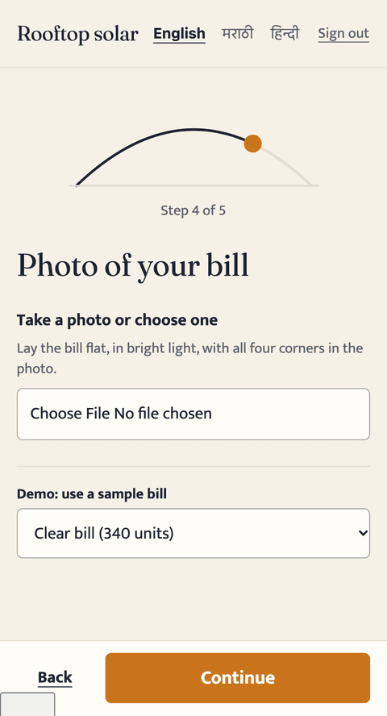 | 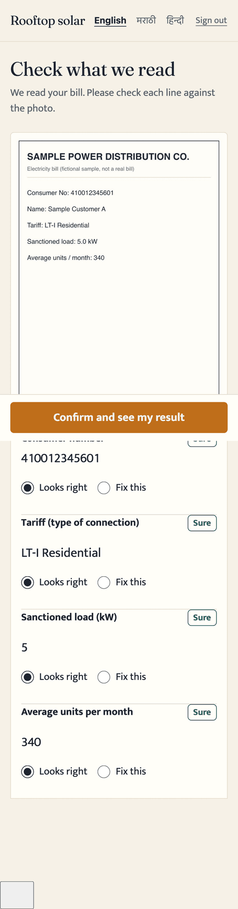 | 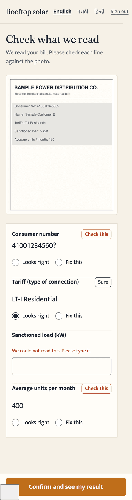 |

| Result (High) | Quote story | After accepting |
|---|---|---|
| 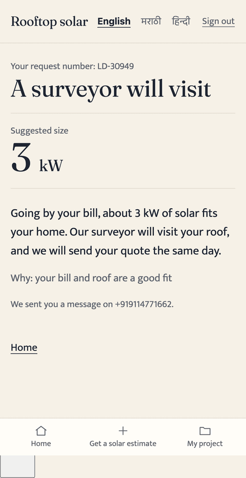 | 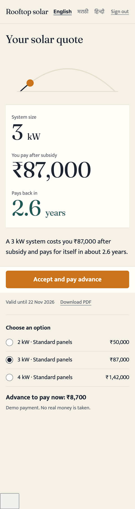 | 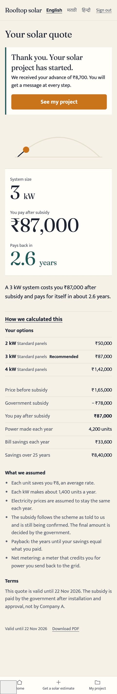 |

| Marathi lead form | Public status (Marathi) | Public status (English) |
|---|---|---|
| 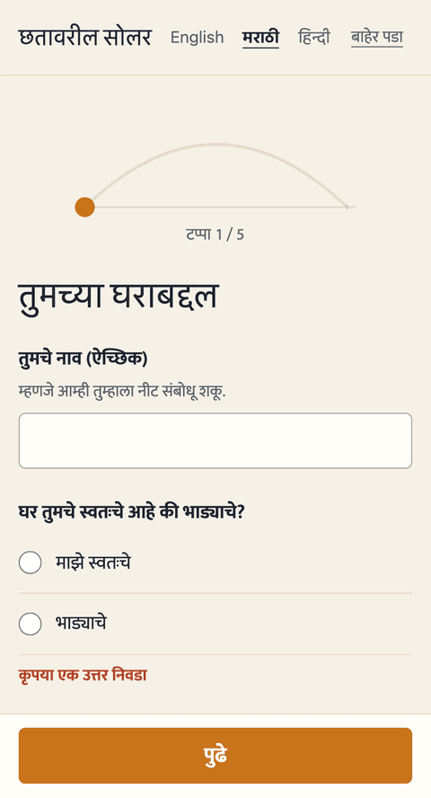 | 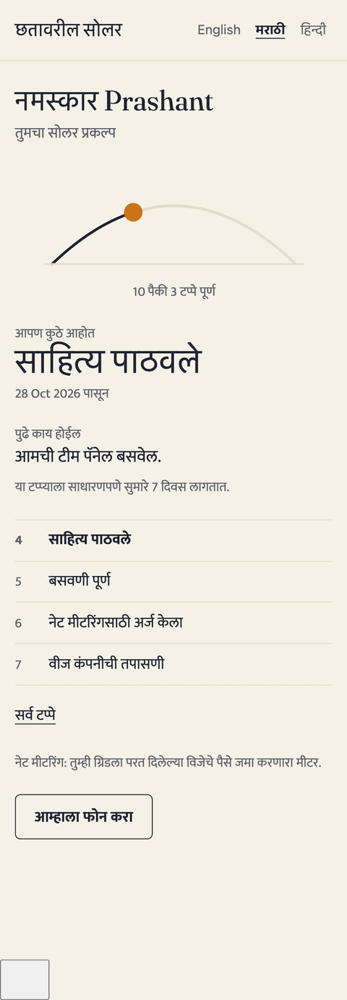 | 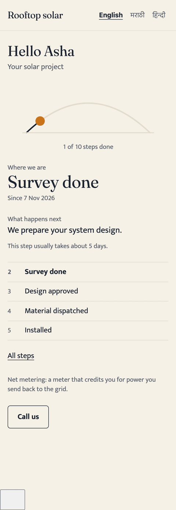 |

Sales desk: 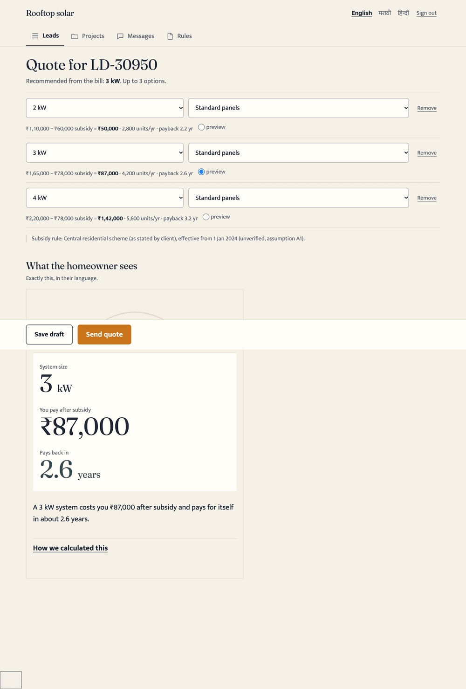 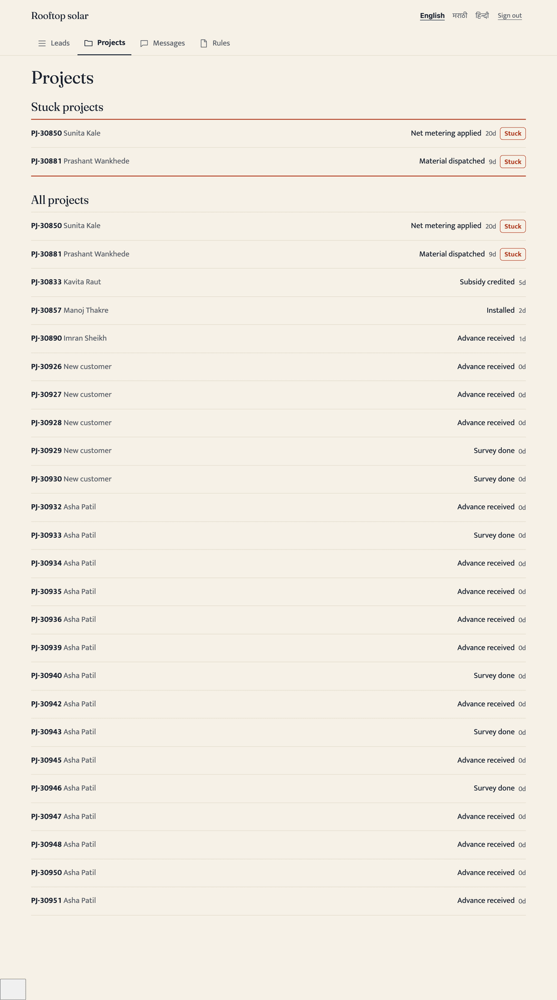

**The 20 UX laws, and the concrete decision for each** (full table: `docs/DESIGN_SYSTEM.md`)

| Law | Decision |
|---|---|
| Aesthetic-Usability | One token set, consistent spacing; no gradients, glass or glow. |
| Hick's | One primary action per screen; the lead form is stepped; quotes are limited to 3 options; the inbox has 3 filters, collapsed. |
| Fitts's | Buttons ≥ 48px, full-width on phones; sticky bottom action bar in the form, bill review and accept; destructive actions are small. |
| Jakob's | OTP boxes with autofill, bottom nav for homeowners, list/detail for sales, native camera/gallery picker. |
| Miller's | ≤ 5 fields per step; ≤ 3 homeowner nav items; the timeline shows the current and next 3 stages, the rest collapsed. |
| Doherty | Staged progress text while a bill is read; skeletons on lists; instant client validation; in-browser photo downscale. |
| Proximity / Common Region | The bill image and its values share one region; the three quote numbers share one surface. |
| Similarity | One style per role: buttons, money, chips. |
| Visual Hierarchy | Quote: big serif numerals → one sentence → details; one H1 per screen. |
| Progressive Disclosure | Stepped form; "How we calculated this"; collapsed timeline. |
| Recognition over Recall | The photo is beside the values; stage names are always visible; known name/phone are not re-asked. |
| Von Restorff | Only the saffron button and the stuck projects are loud. |
| Peak-End | The quote reveal is the peak; the confirmation after accepting and the "short call" message are warm and clear about what happens next. |
| Goal-Gradient | Sun-arc "Step 3 of 5"; the timeline shows how far toward "Subsidy credited". |
| Serial Position | Headline numbers first; the accept action last. |
| Tesler's | The app derives kW, the rule row, generation and payback; sales sees which rule applied but never computes. |
| Postel's | Phone with/without +91, spaces, dashes; "₹3,200"; sq ft or sq m; Devanagari digits; photos of any size/orientation. Output is normalised. |
| Occam's | Rule-based scoring, no AI service, few dependencies, minimal fields. |
| Feedback Loops | Inline confirmations, loading buttons, a message preview after every stage change, form errors that say how to fix them, and stored corrections. |

**Accessibility.** WCAG 2.2 AA is enforced by automated axe audits at 360px width on the sign-in, status, home, lead form, bill review, quote, tracker and all sales screens (all pass), plus keyboard-usable controls, visible focus, `aria-live` on progress, `lang` that follows the locale, and reduced-motion support. One honest note: white text on the saffron button measures 3.50:1, which passes only as large text, so primary labels are 19px bold. The palette contrast is computed in a unit test.

**Languages.** English is complete. Marathi and Hindi cover sign-in, the lead form, bill-review messages, the result, the quote story and PDF, the status page, stage names and message templates; everything else (the sales desk) falls back to English by design. Translations are **drafts that need native-speaker review**.

## 8. Security and privacy

Detail: `docs/SECURITY.md`. Implemented and tested:
- **Access control** is enforced on the server for every read, deny by default. Tests prove a homeowner cannot read another's lead, bill image, quote, quote PDF, project or document by ID tampering; unknown or malformed IDs return "not found" (no existence leak).
- **OTP:** 6 digits, hashed, 5-minute expiry, 5 attempts, single use, constant-time compare, per-phone and per-IP limits stored in the database (so they hold across serverless instances).
- **Sessions:** signed httpOnly, SameSite=Lax cookie; a new session on each login; logout revokes server-side (tested by replaying the old cookie).
- **Uploads:** magic-byte check (not the declared type), 5 MB cap, re-encoded server-side, random storage keys, served only through an authorised route, never from a public path.
- **Status links:** 256-bit random token shown once, only its hash stored, revocable, regenerable, rate-limited, `noindex`; the public page shows only first name, stage, timeline and document names.
- **Headers:** strict CSP with a per-request nonce, HSTS, nosniff, frame-ancestors none, Permissions-Policy.
- **CSRF:** SameSite cookies plus Next.js's built-in Origin check on server actions; no state change on GET.
- **Secrets:** none in the repo (gitleaks clean on the full history and tree); `.env*` ignored; `.env.example` has names only. `npm audit --omit=dev` reports 0 vulnerabilities; the moderate findings in the full audit are dev tooling only.
- **DPDP:** consent (text version + time), minimisation, masking, audit-logged unmasking. Hosting in an India region is a documented production requirement.

**Known gaps:** mock OTP and payments; bill images stored in the database for the demo; no MFA for sales; no malware scan on uploads; the retention job (delete bill images 180 days after a lead closes) is documented, not scheduled; Neon's Mumbai region must be chosen at deploy.

## 9. Testing and measured results

- **231 unit and integration tests** (Vitest) and **10 end-to-end tests** (Playwright, mobile viewport) all pass. `lib/rules` coverage: 100% statements, lines and functions, 99% branches (gate: 95%).
- Covered: every must-test item in the brief: subsidy cases, effective-date boundaries, overlap/gap errors, generation and payback, kW sizing, scoring (the three sample leads and boundaries), the reader's good/poor/ambiguous/malformed/unknown paths, OTP rules, IDOR, status tokens, quote snapshotting, input validation, forged and oversized uploads.
- **E2E flows:** (1) sign in → lead → confirm bill → result; (2) sales builds and sends a quote → homeowner accepts → project appears, with a real PDF and an IDOR check; (3) sales moves a stage → message logged → public link updates → revoke. Plus Marathi/Hindi, axe at 360px, security headers, deny-by-default and logout revocation.
- **Lighthouse (production build, mobile, measured):**

| Profile | Performance | Accessibility | Best practices | FCP | LCP |
|---|---|---|---|---|---|
| Standard mobile (simulated slow 4G) | **98** | **100** | **100** | 1.1 s | 2.5 s |
| Brief's strict profile (slow 3G, 4× CPU) | **69–73** | **100** | **100** | 2.4–3.2 s | 7.3–8.1 s |

**The strict 3G target (first load < 3 s, Performance ≥ 90) was not met.** The reason is measured, not guessed: blocking all JavaScript drops LCP from 7.7 s to 4.0 s, so the cost is the React + Next runtime (about 117 KB gzip) that every App Router page ships; the lead flow loads about 158 KB of JS against the ≈100 KB budget. I cut total transfer from 391 KB to 215 KB (self-hosted Fraunces subset: 61 KB → 11 KB; Devanagari font fetched only when needed). Reaching the strict target would need a lighter approach for the public pages. Full detail: `docs/LIGHTHOUSE.md`.

## 10. Every assumption (labelled)

The numbered register with where each is used and how to change it is `docs/ASSUMPTIONS.md`. Summary:

- **A1/A2 (unverified):** subsidy ₹30,000/kW up to 2 kW + ₹18,000 for the 3rd, capped at ₹78,000, effective 2024-01-01. From the client's statement; **verify before launch**.
- **A3** rule interval is start-inclusive, end-exclusive · **A4** sizes are whole or half kW · **A5** recommended kW = nearest whole kW, minimum 1 · **A6** 1,400 units/kW/year, editable · **A7** flat ₹8/unit tariff · **A8** 0% yearly tariff rise · **A9** prices ₹55,000/kW standard and ₹60,000/kW premium · **A10** commercial customers get no subsidy unless a rule row exists.
- **A11** scoring thresholds · **A12** about 100 sq ft of roof per kW · **A13** Vidarbha pincodes are a soft hint only · **A14** stage list and stuck thresholds · **A15** admin is a flag on a sales user · **A16** bill images stored in the database for the demo · **A17** retention: delete bill images 180 days after a lead closes · **A18** OTP is mocked · **A19** duplicate = same phone and pincode within 7 days · **A20** the client's ₹86.88 lakh loss figures are unverified.
- **A21** quote valid 15 days · **A22** advance = 10% of net cost (mock) · **A23** bill reading is simulated · **A24** Asia/Kolkata display time · **A25** MR/HI need native review · **A26** Medium score goes to a survey, Low to a short call.
- **A27** consumer numbers are 10–14 digits · **A28** manual entry is low confidence · **A29** very large bill or load = small-business path · **A30** implausible values flagged, not blocked · **A31** name optional · **A32** "sure" at confidence ≥ 0.85 · **A33** demo status tokens are public on purpose.

## 11. What was cut (honestly)

Real WhatsApp/SMS · real payments · real OCR/vision reading and its accuracy evaluation · any DISCOM or government subsidy portal · full offline sync for sales · an admin screen to **edit** price and subsidy rules (a read-only view exists; changes are new dated rows via SQL/seed) · the stuck dashboard as anything more than a list · Marathi/Hindi on sales screens · dark mode · the coordinator and MD roles · native review of the translations · the strict 3G performance target (see section 9) · edge cases not handled: a bill with several meters (sales handles it on the call), and editing owner/tenant after the form is submitted (a tenant who is really the owner's representative must ask sales to correct it; sales can already correct the bill values, with an audit trail) · the retention job exists as a script (`npm run retention`, dry-run by default) but is not scheduled.

## 12. What I would do next

1. **Verify the subsidy rules** with the client and get a sign-off; keep the dated-table design.
2. **A real messaging provider** behind `lib/messaging/provider.ts`, and real OTP delivery.
3. **A real OCR/vision reader** behind the existing adapter, then **measure accuracy** from the stored extracted-vs-confirmed pairs before trusting any number.
4. **Funnel analytics** tied to the three success measures (unqualified-survey rate, same-day-quote rate, status-call volume).
5. **Rule-table admin UI** with overlap validation; **survey mobile app** with offline support.
6. **India-region hosting and retention jobs** (delete bill images after the retention window; a deletion-on-request tool).
7. **Performance:** a JS-free public status page and a lighter shell to reach the strict 3G budget.
8. Native-speaker review of Marathi and Hindi copy; MFA for sales.
